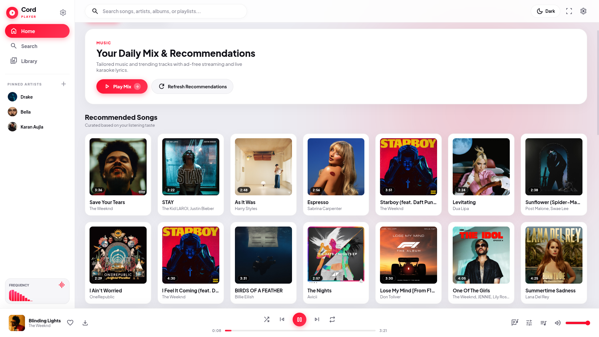
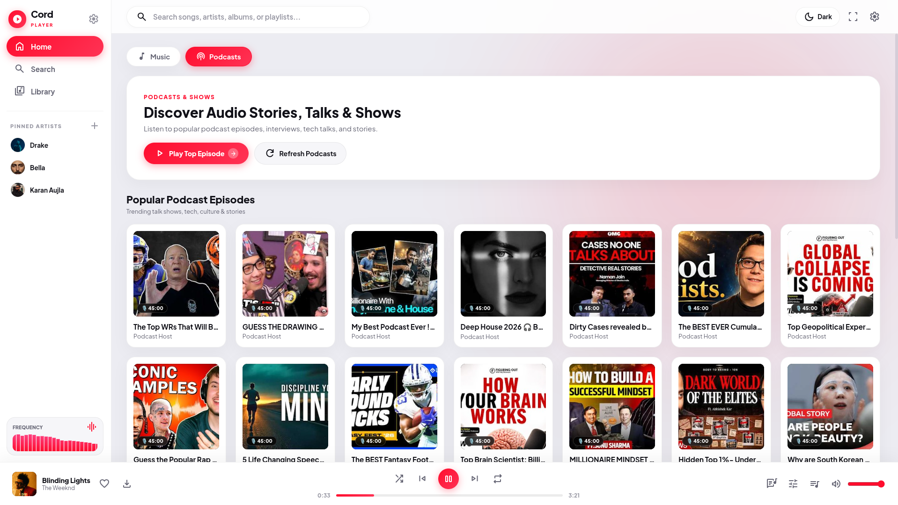
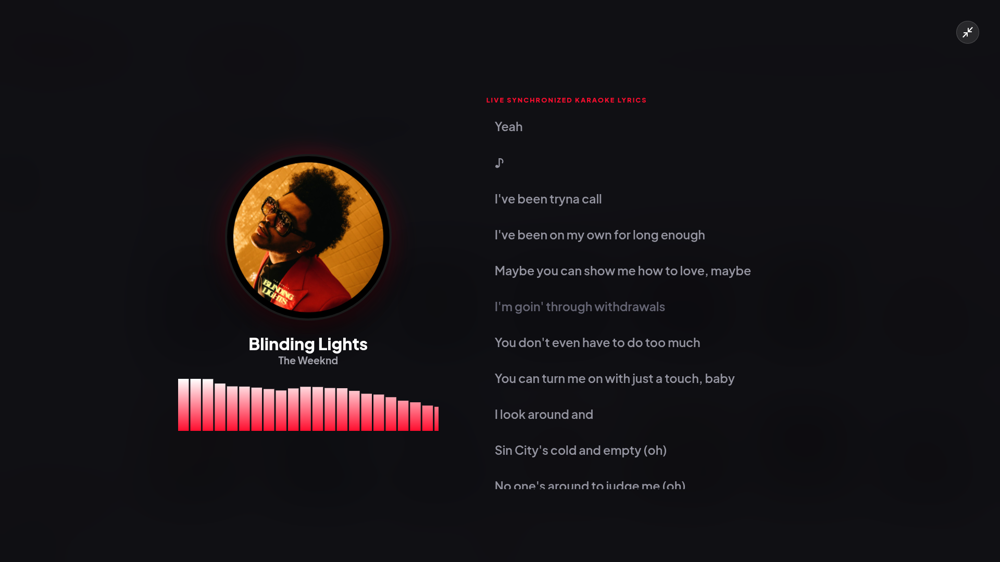
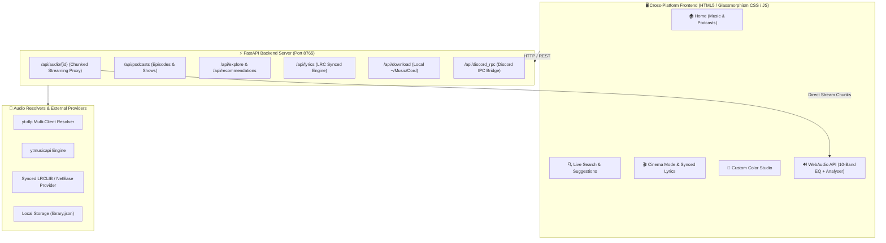

<div align="center">

# 🎵 Cord Player

### *Next-Generation Cross-Platform Desktop & Mobile Music Streaming Engine*

[](https://github.com/himanshu-xyz-1/Cord-player)
[](https://github.com/himanshu-xyz-1/Cord-player/releases/download/v2.5.0/CordPlayer.apk)
[](https://microsoft.com/windows)
[](https://apple.com/macos)
[](https://archlinux.org)
[](LICENSE)

<br/>

> **Cord Player** is a sleek, ultra-responsive, ad-free music & podcast player built with glassmorphism UI, real-time WebAudio processing, live synchronized karaoke lyrics, 10-band studio equalizer, offline downloading, and Discord Rich Presence. Runs natively on **Windows**, **macOS**, **Linux**, and **Android**.

<br/>

<a href="https://github.com/himanshu-xyz-1/Cord-player/releases/download/v2.5.0/CordPlayer.apk">
  
</a>

<br/><br/>

[📱 Android App](#-android-mobile-app) • [✨ Features](#-key-features) • [📸 Screenshots](#-visual-showcase) • [⚡ Desktop Quick Start](#-desktop-quick-start) • [🎛️ Architecture](#-system-architecture) • [⌨️ Shortcuts](#️-keyboard-shortcuts)

---

</div>

<br/>

## 📱 Android Mobile App

Get the full standalone **Cord Player** mobile experience directly on your Android phone!

<div align="center">

<a href="https://github.com/himanshu-xyz-1/Cord-player/releases/download/v2.5.0/CordPlayer.apk">
  
</a>

<br/>

**[View all Android Releases](https://github.com/himanshu-xyz-1/Cord-player/releases)** • *File size: 5.44 MB • Android 7.0+ (Nougat to Android 14+)*

</div>

<br/>

### 🌟 Android Highlights:
- 🔒 **Continuous Screen-OFF Playback**: Integrated with Android's `MediaPlaybackService` and CPU WakeLock—music keeps playing uninterrupted when your phone screen turns off, when locked, or while using other apps.
- 📱 **Lock-Screen Media Controls**: Full live scrubber seek bar, high-resolution album artwork, track details, and quick play/pause/skip buttons in your notification shade and lock screen.
- 🎧 **Bluetooth & Headphone Support**: Full hardware media button integration (AirPods, Galaxy Buds, wired headsets, and smartwatches).
- 🎚️ **Hardware Equalizer & Synced Karaoke Lyrics**: Native real-time WebAudio engine with syllable-accurate auto-scrolling lyrics right on mobile.
- 🚀 **100% Standalone**: Installs directly from the `.apk` without needing a computer running.

#### 📲 How to Install:
1. Download **[CordPlayer.apk](https://github.com/himanshu-xyz-1/Cord-player/releases/download/v2.5.0/CordPlayer.apk)** directly on your Android device.
2. Tap the downloaded `.apk` file and grant *"Install from this source"* if prompted.
3. Open **Cord Player** from your app drawer and enjoy unlimited ad-free music!

<br/>

---

## 📸 Visual Showcase

<div align="center">

### 🎵 Dynamic Home & Daily Recommendations
*Curated personal mix, global trending hits, and real-time audio visualizer.*



<br/><br/>

### 🎙️ Dedicated Podcasts & Audio Shows Hub
*Popular podcast episodes with duration badges, creator profiles, and direct one-click playback.*



<br/><br/>

### 🎬 Immersive Cinema Mode with Live Karaoke Lyrics
*Synced lyrics tracking, interactive click-to-seek, glowing vinyl artwork, and dual-tone frequency analyzer.*



</div>

<br/>

---

## ✨ Key Features

<table>
  <tr>
    <td width="50%">
      <h3>🚀 Blazing Fast Ad-Free Streaming</h3>
      <ul>
        <li><b>Sub-second audio loading</b> via multi-client stream resolution (<code>android</code>, <code>ios</code>, <code>web</code>).</li>
        <li>100% ad-free playback with adaptive bitrate streaming (up to 320kbps).</li>
        <li>Continuous uninterrupted playback with Smart Radio queueing.</li>
      </ul>
    </td>
    <td width="50%">
      <h3>🎤 Live Synchronized Karaoke Lyrics</h3>
      <ul>
        <li>Real-time syllable & line synchronization with smooth auto-scrolling.</li>
        <li><b>Interactive Seek</b>: Click any lyric line to jump directly to that timestamp.</li>
        <li>Plaintext and Romanized fallback support for international languages.</li>
      </ul>
    </td>
  </tr>
  <tr>
    <td width="50%">
      <h3>🎚️ 10-Band Studio Equalizer & Booster</h3>
      <ul>
        <li>Precision biquad filter chain (<code>60Hz</code> to <code>16kHz</code>).</li>
        <li>Pre-calibrated presets: <i>Bass Boost, Vocal, Rock, Pop, Electronic, Classical</i>.</li>
        <li>Hardware volume pre-amp booster up to <b>150%</b>.</li>
      </ul>
    </td>
    <td width="50%">
      <h3>📥 Offline Music Downloader</h3>
      <ul>
        <li>Download full tracks offline directly to <code>~/Music/Cord/</code>.</li>
        <li>Embedded ID3 tags, artist metadata, and high-resolution album artwork.</li>
        <li>Dedicated Offline Library section with instant storage management.</li>
      </ul>
    </td>
  </tr>
  <tr>
    <td width="50%">
      <h3>🎨 Custom Color Studio & Theming</h3>
      <ul>
        <li>15 curated vibrant presets + custom hex gradient generator.</li>
        <li><b>Dynamic Aura</b> ambient lighting vs <b>Solid Slate</b> minimal mode.</li>
        <li>Morphing border radius: <i>Pill (28px)</i>, <i>Standard (16px)</i>, <i>Sharp (6px)</i>.</li>
      </ul>
    </td>
    <td width="50%">
      <h3>🎮 Discord Rich Presence & MediaSession</h3>
      <ul>
        <li>Broadcast current track, artist, album art, and live elapsed timer to Discord.</li>
        <li>Native OS MediaSession integration (play/pause/skip via media keys).</li>
        <li>Multi-device output sink selector for Bluetooth headphones & DACs.</li>
      </ul>
    </td>
  </tr>
</table>

<br/>

---

## ⚡ Desktop Quick Start

### 🪟 Windows (10 / 11)

1. Clone or download the repository:
   ```cmd
   git clone https://github.com/himanshu-xyz-1/Cord-player.git
   cd Cord-player
   ```
2. Double-click **`run.bat`** (or execute via Command Prompt / PowerShell):
   ```cmd
   pip install -r requirements.txt
   python main.py
   ```
> **Note**: Cord Player automatically detects **Microsoft Edge** or **Google Chrome** and launches as a native borderless desktop app with full WebAudio acceleration.

<br/>

### 🍎 macOS (Apple Silicon & Intel)

1. Clone the repository:
   ```bash
   git clone https://github.com/himanshu-xyz-1/Cord-player.git
   cd Cord-player
   ```
2. Run via terminal:
   ```bash
   pip install -r requirements.txt
   python3 main.py
   ```
   *(Or double-click `run.sh`)*

<br/>

### 🐧 Linux (Arch, Ubuntu, Fedora, Debian)

```bash
git clone https://github.com/himanshu-xyz-1/Cord-player.git
cd Cord-player
pip install -r requirements.txt
python3 main.py
```

<br/>

---

## 🎛️ System Architecture



<br/>

---

## ⌨️ Keyboard Shortcuts

| Shortcut | Action |
| :--- | :--- |
| <kbd>Space</kbd> | Toggle Play / Pause |
| <kbd>→</kbd> / <kbd>←</kbd> | Seek forward / backward (configurable: 5s, 10s, 15s, 30s) |
| <kbd>Ctrl</kbd> + <kbd>→</kbd> | Play Next Track |
| <kbd>Ctrl</kbd> + <kbd>←</kbd> | Play Previous Track |
| <kbd>↑</kbd> / <kbd>↓</kbd> | Volume Up / Down (+5% / -5%) |
| <kbd>M</kbd> | Mute / Unmute Audio |
| <kbd>S</kbd> | Toggle Shuffle Mode |
| <kbd>R</kbd> | Cycle Repeat Mode (*Off → All → One*) |
| <kbd>F</kbd> | Open Wide-Screen Cinema Mode with Synced Lyrics |
| <kbd>/</kbd> | Focus Global Search Bar |
| <kbd>Esc</kbd> | Close Popups / Exit Cinema Mode |

<br/>

---

## 📂 Project Structure

```
cord-player/
├── android/                 # Native Android Studio Project
│   ├── app/src/main/        # AndroidManifest, Java Services & XML layouts
│   └── app/build.gradle     # Android Gradle build & dependencies
├── backend/
│   ├── main.py              # FastAPI application & REST routing
│   ├── ytmusic.py           # Multi-endpoint audio extraction & search
│   ├── lyrics.py            # Synchronized LRC lyrics parser
│   └── discord_rpc.py       # Discord Rich Presence IPC client
├── frontend/
│   ├── index.html           # Core application markup & PWA tags
│   ├── manifest.json        # Mobile / Android PWA manifest
│   ├── style.css            # Responsive Glassmorphism styles & animations
│   └── app.js               # WebAudio graph, player state & DOM engine
├── assets/                  # Icons, SVGs, and visual presets
├── docs/screenshots/        # Repository showcase screenshots
├── main.py                  # Standalone cross-platform launcher
├── run.bat                  # 1-Click Windows launcher script
├── run.sh                   # 1-Click macOS & Linux launcher script
├── requirements.txt         # Python package dependencies
└── README.md                # Project documentation
```

<br/>

---

## 📄 License

Distributed under the **MIT License**. See `LICENSE` for more information.

<div align="center">

Crafted with ❤️ by [Himanshu Joshi](https://github.com/himanshu-xyz-1)

</div>
